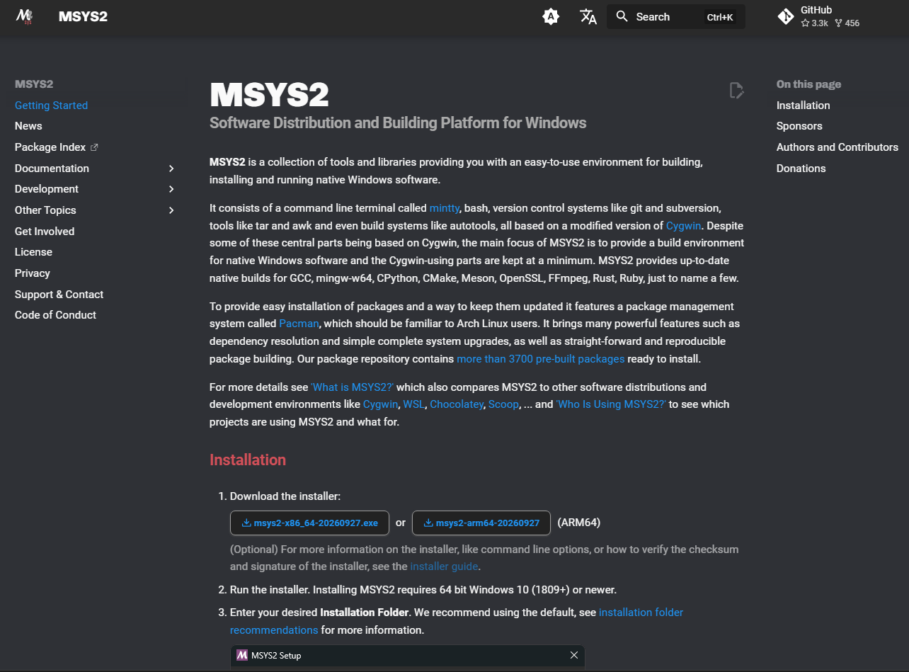
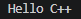

# 競技プログラミング
今回より競技プログラミングを行う  
競技プログラミングとは、    
出題される課題をプログラムによって制限時間内に解決し、その正確さや速さを競い合うスポーツのような競技。  
下記のような問題を解くことになる。

## 例題
出典: AtCoder Beginner Contest 049 C - 白昼夢  
https://atcoder.jp/contests/abs/tasks/arc065_a

### 問題文
英小文字からなる文字列 $S$ が与えられます。  
$T$ が空文字列である状態から始め、以下の操作を好きな回数繰り返すことで **$S = T$** とすることができるか判定してください。

* $T$ の末尾に `dream`, `dreamer`, `erase`, `eraser` のいずれかを追加する。

---

### 制約
* $1 \le \vert{}S\vert{} \le 10^5$
* $S$ は英小文字からなる。

---

### 入力
入力は以下の形式で標準入力から与えられます。

```text
S
```

### 出力
S=T とすることができる場合 YES を、そうでない場合 NO を出力せよ。

# 解説
最初に"dreamdreamereraseeraser" ←のようなランダムな文字列が与えられ、  
その文字列が"dream","dreamer","erase","eraser"の組み合わせで作れる文字列かどうかを判定する、という問題。  
ちなみに文字列Sは、1文字から10万文字となるという制約がついている。  
人間の手で解くには途方もない時間が必要になるので、プログラミングを用いて解く必要がある。  

# 本題
今回はこの問題を解くためのC++言語の環境構築を行う。  
## ステップ1 MSYS2インストール  


https://www.msys2.org/  

* インストール
* MSYS2を開いて更新やセットアップ
* 環境変数の設定 
* vscodeでのデバッガのセットアップ  
色々    

## 動作テスト
テスト用プログラムを用意したのでvscodeでコンパイルとデバックしてみる。
``` C++
#include <iostream>
using namespace std;

int main() {
    cout << "Hello C++ " << endl;
    return 0;
}
```  
出力  
 
