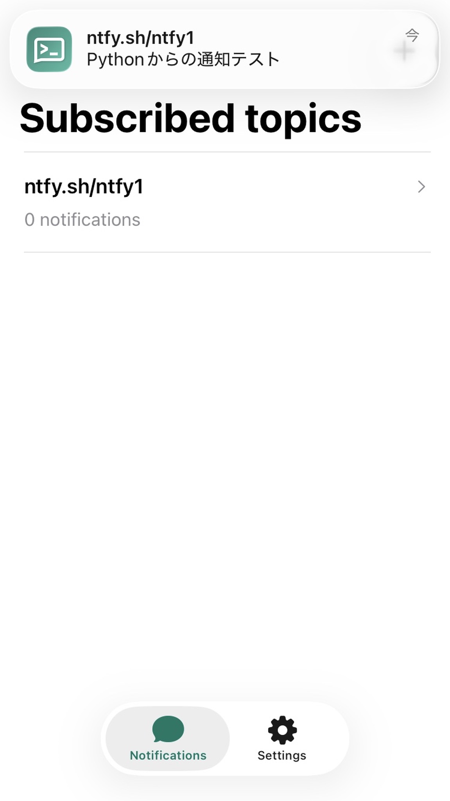
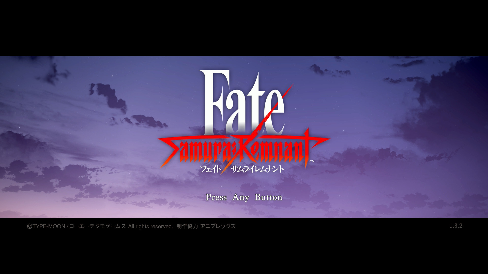
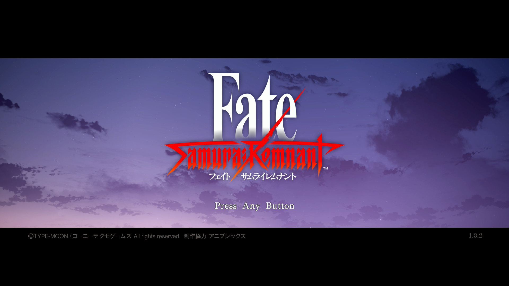

# 【設計】  
PS5の画面を常時監視し、
特定の状態になったら通知するプログラムを作成する。  
先に通知部分を作成する。  

# 【通知部分】  
ntfyという、楽に通知が送れるiphoneアプリがあったのでそれを使用した。  
tst_ntfy.pyを作成    
実行するとiphoneに通知が送られる(下はスクリーンショット)。  
通知系のプログラムは以前作成したが、こちらの方がシンプルな実装となる。  
  

# 【特定の状態になったら~部分】  
パターンマッチングという手法を使い、画面の一致率を調べる。  
tst_patternMatch.py を作成。  
```python
import cv2
import numpy as np

img1 = cv2.imread("pic02_gameSS1.png")
img2 = cv2.imread("pic03_gameSS2.png")

if img1 is None or img2 is None:
    raise FileNotFoundError("画像を読み込めません")

if img1.shape != img2.shape:
    raise ValueError("画像のサイズが一致していません")

# 各画素のRGB値の絶対差
diff = np.abs(img1.astype(np.int16) - img2.astype(np.int16))

# 平均絶対誤差（0～255）
mae = np.mean(diff)

# 誤差を0～100%の範囲に変換した一致度
similarity = (1 - mae / 255) * 100

print(f"平均絶対誤差: {mae:.2f}")
print(f"一致度: {similarity:.2f}%")
```

   
将来的に一致率がn%を下回ったら~ 画面が切り替わったと判断する。という風に使用する。  


雲が少しだけ動いた画像を用意したので先程のプログラムで判定してみる。  
```
    平均絶対誤差: 5.59
    一致度: 97.81%
```
画像の一致率は97.81%であることがわかった。  
よく似た画像なので結果としても納得がいくだろう。

最初にでてくる、平均絶対誤差は、画像のピクセル(画素)が平均してどれぐらい色が離れているかを表す。  
今回の平均絶対誤差は5.59なので、この画像らは平均して5.59単位、色が離れているということになる。
      
ちなみに一致度はこの平均絶対誤差を用いて計算されている。式は下記の通り
```
一致率 = (1 - 平均絶対誤差 / 255) * 100
```

今回作ったパターンマッチングプログラムと前回作った通知用プログラムを組み合わせ、  
目的の「画面が特定の状態の状態になったら通知するプログラム」を作成していく。

次回はps5の画面をキャプチャボードから取り込んで処理する。部分を作成する。  
